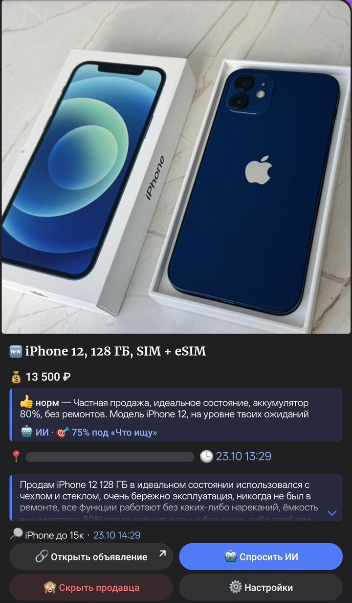
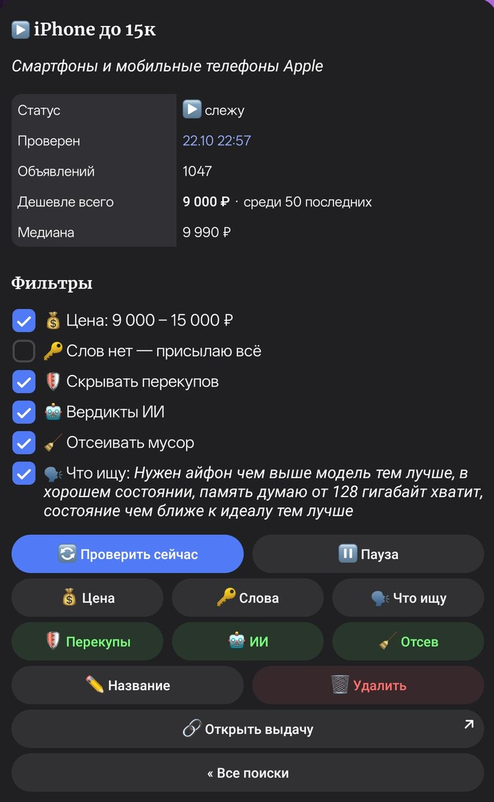
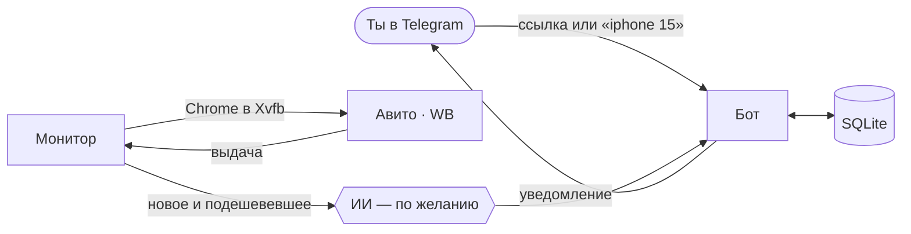

<p align="center">
  
</p>

<h1 align="center">avito-watch</h1>

<p align="center">
  Telegram-бот, который следит за поиском на Авито и Wildberries<br>
  и присылает новые объявления и снижение цен
</p>

<p align="center">
  <a href="https://github.com/Case211/avito-watch/actions/workflows/tests.yml"></a>
  <a href="LICENSE"></a>
  
  
</p>

<p align="center">
  
  &nbsp;
  
</p>

## Что умеет

- 🔎 **Следит за поиском.** Пришли ссылку на выдачу Авито или WB со своими фильтрами — или просто напиши, что ищешь.
  Бот сам заглядывает туда (Авито — раз в 40–60 минут, WB — раз в 15–25) и присылает новое и подешевевшее: с фото,
  ценой, началом описания и кнопкой на сайт.
- 📉 **История цены** — «25 000 → 23 000 → 20 000 ₽», а находка дешевле медианы выдачи приходит с пометкой
  «💡 На 18% дешевле медианы».
- 🔑 **Ключевые слова** с окончаниями и минусами: `торг, хорош* состоян*, -на запчасти`. Регистр, ё и латинские
  двойники русских букв («Пpoдаю», «oтличнoм») не мешают.
- 💰 **Диапазон цены** поверх фильтров самой ссылки: `10000-20000`, `от 15 000`, `до 20 тыс`, `10–20к`.
- 🙈 **Скрыть продавца** одной кнопкой, 🛡 **без перекупов** — магазинов, которые выдают себя за частников.
- 🏷 **Товар WB по ссылке** — слежка за его ценой и за тем же товаром у других продавцов.
- 🤖 **ИИ, по желанию** — вердикт к каждой находке (приманка, не то, подозрительно), «Что ищу» своими словами с оценкой
  совпадения, отсев мусора, разбор объявления по кнопке и память о моделях.
- 🌙 **Тихие часы и ночная пауза**; если сайт ограничил доступ, бот пережидает, а не долбит.
- ✨ **Rich-сообщения Bot API 10**: фото внутри сообщения, таблицы, чек-листы, сворачиваемые разделы, цветные кнопки.
  Не примет их Telegram — то же уйдёт обычным HTML, уведомление не потеряется.

## Как это работает

Простые HTTP-запросы оба сайта режут, поэтому выдачу открывает настоящий Google Chrome через
[patchright](https://pypi.org/project/patchright/) (Playwright без следов автоматизации): в виртуальном экране Xvfb, с
постоянным профилем и WebGL на встроенной видеокарте. С Авито бот берёт карточки со страницы, с WB — JSON, который
сайт загрузил сам; своих запросов к API сайтов он не шлёт.



## Что нужно

- **Linux-сервер x86-64 с Docker** — мини-ПК, неттоп, старый ноутбук. Образ весит около 2 ГБ, памяти бот берёт до 2 ГБ.
- **Домашний интернет в России.** Бот рассчитан на обычный домашний адрес: к адресам дата-центров и зарубежным
  антиботы сайтов обычно строже.
- **Встроенная видеокарта Intel или AMD** (`/dev/dri`) — для WB: без WebGL он не пускает. Авито пускает и без неё.
- **Бот Telegram** — токен выдаёт [@BotFather](https://t.me/BotFather).
- **По желанию — ключ API Anthropic** для ИИ.

## Быстрый старт

```bash
git clone https://github.com/Case211/avito-watch.git
cd avito-watch
cp .env.example .env                          # впиши BOT_TOKEN и ADMIN_IDS
mkdir -p data && sudo chown 1000:1000 data    # бот в контейнере работает от uid 1000
docker compose up -d --build
docker compose logs -f                        # «Run polling for bot @…» — бот на связи
```

Свой Telegram ID для `ADMIN_IDS` покажет, например, [@userinfobot](https://t.me/userinfobot). Остальным бот отвечает,
что он частный.

**Видеокарта для WB.** Узнай номера групп `render` и `video` на сервере и допиши их в `.env` вместе с
`COMPOSE_FILE` — так подключится `docker-compose.gpu.yml`:

```bash
getent group render video    # render:x:991:   video:x:44:
```

```ini
COMPOSE_FILE=docker-compose.yml:docker-compose.gpu.yml
RENDER_GID=991
VIDEO_GID=44
```

После `docker compose up -d` в логе появится строка `WebGL в браузере: ANGLE (Intel, …)`, без видеокарты — предупреждение.

**Telegram недоступен напрямую?** Задай `TELEGRAM_PROXY=socks5://127.0.0.1:1080`: через прокси бот ходит только в
Telegram, сайты браузер открывает напрямую. Контейнер живёт в сети хоста, поэтому `127.0.0.1` — это сам сервер.

## Как пользоваться

- **Ссылка на поиск** Авито или выдачу WB — бот начнёт следить и пришлёт сводку со свежими объявлениями. Авито он
  смотрит по дате, WB — новинками вперёд, если сортировка не задана: «по популярности» выдача перемешивается.
  Ссылку можно прислать и с текстом вокруг — так её отдаёт «Поделиться» в приложении.
- **Просто текст** («iphone 15») — бот спросит, где искать: на Авито (в городе `AVITO_CITY`) или на WB. Просьбу
  своими словами («нужна ddr4 для неттопа, so-dimm, от 8 ГБ одной плашкой») ИИ сначала разберёт: в поиск сайта уйдёт
  суть («DDR4 SO-DIMM 8 ГБ»), а пожелания и цена — в настройки поиска. Поиск сайта ищет по каждому слову, и фраза
  целиком приводит чужое: на ту просьбу WB нашёл 34 тысячи товаров — формы для выпечки и мыла, а на запрос — 463
  модуля памяти.
- **Ссылка на товар WB** — его цена и тот же товар у других продавцов («Все N предложений»).
- **📋 Мои поиски** (`/list`) — список поисков, по нажатию — карточка: статистика, фильтры и кнопки «🔄 Проверить
  сейчас», «🔑 Слова», «💰 Цена», «🗣 Что ищу», «🛡 Перекупы», «🧹 Отсев», «⏸ Пауза».
- **❓ Помощь** (`/help`) — как добавить поиск и что умеет бот.

Под уведомлением — кнопки на сайт, «🙈 Скрыть продавца», «🤖 Спросить ИИ» и «⚙️ Настройки» поиска.

## Настройки

Всё — в `.env`; обязательны только `BOT_TOKEN` и `ADMIN_IDS`.

| Переменная | По умолчанию | Что это |
|---|---|---|
| `BOT_TOKEN` | — | токен бота от @BotFather |
| `ADMIN_IDS` | — | Telegram ID через запятую — кому можно пользоваться ботом |
| `TZ` | `Europe/Moscow` | часовой пояс: тихие часы, ночь и время в сообщениях |
| `AVITO_CITY` | `moskva` | город для поиска по тексту — как в адресе `avito.ru/<город>` |
| `AVITO_CITY_NAME` | `Москве` | он же для людей: «ищу в Москве» |
| `AVITO_MINUTES` | `40-60` | минуты между проверками поиска Авито, случайно в этих пределах |
| `WB_MINUTES` | `15-25` | то же для WB |
| `QUIET_HOURS` | `23-8` | уведомления без звука; пусто — всегда со звуком |
| `NIGHT_HOURS` | `1-7` | ночью без проверок, кроме «Проверить сейчас»; пусто — круглые сутки |
| `TELEGRAM_PROXY` | — | прокси только для Telegram |
| `ANTHROPIC_API_KEY` | — | ключ API Anthropic; пусто — бот без ИИ |
| `AI_PROXY` | — | прокси только для Anthropic |
| `AI_VERDICT_MODEL` | `haiku` | модель для вердиктов |
| `AI_ASK_MODEL` | `sonnet` | модель для разбора по кнопке |
| `COMPOSE_FILE`, `RENDER_GID`, `VIDEO_GID` | — | видеокарта для WB, см. выше |

## ИИ

С ключом API Anthropic в `.env` бот подключает Claude; без ключа всё работает так же, только без вердиктов и разборов.

- **Вердикт** к каждой находке строкой в уведомлении: 🤖 норм, 🎣 приманка магазина, 🗑 не то (чехол вместо телефона,
  «куплю», другая модель), 🚩 подозрительно (предоплата, уход в мессенджеры). Находки проверки идут к быстрой модели
  пачкой — до 20 за запрос.
- **«🗣 Что ищу»** — пожелание своими словами («M1 Pro, 16 ГБ, батарея от 85%»): ИИ сверяет с ним каждое объявление и
  пишет 🎯 N %.
- **«🧹 Отсев»** — приманки и не тот товар не приходят по одному, а собираются в тихую сводку со ссылками и причинами.
  Подозрительные приходят всегда: решать тебе.
- **«🤖 Спросить ИИ»** — разбор моделью посильнее: цена против медианы и истории, типичные болячки модели, что спросить
  у продавца и проверить при встрече (на WB — в пункте выдачи). Полчаса после ответа можно задавать уточняющие вопросы.
- **Память о моделях.** Первый разбор модели составляет чек-лист «что проверить у этой модели», бот его запоминает, и
  следующие разборы выходят короче и дешевле. «🧠 Память ИИ» в списке поисков — посмотреть, дописать, забыть.

Под капотом — Claude Code из пакета `claude-agent-sdk`: без инструментов, без настроек и без сохранения сессий, модель
только читает текст объявлений и отвечает. Тексты объявлений — чужие данные: в запросе они помечены как данные, а
навредить модели нечем. Не ответил ИИ — уведомления уходят без вердиктов, бот один раз предупреждает и 15 минут его не
зовёт. Если Anthropic недоступен напрямую — `AI_PROXY`.

## Бережно к сайтам

Авито ограничивает частые заходы с одного адреса («Доступ ограничен: проблема с IP»), поэтому бот:

- проверяет все поиски за один запуск браузера, с паузами между ними, а интервалы берёт случайно и растягивает с
  числом поисков — не меньше 2 минут на каждый;
- пускает «Проверить сейчас» не чаще раза в 3 минуты, а ночью переносит проверки на утро;
- если сайт ограничил доступ, ставит на паузу только его поиски: от часа, каждая следующая вдвое дольше, до 6 часов;
  спокойные часы паузу сокращают. Пауза хранится в базе и переживает перезапуск;
- открывает страницу объявления, только если описания в карточке мало, — не больше 10 за проверку; фото в
  уведомлении — ссылкой, Telegram скачивает его сам.

⚠️ Домашний адрес обычно общий на всю квартиру: если Авито его ограничит, капчу увидят и браузеры домашних.

## Ограничения

- **Ozon** не поддерживается: его антибот узнаёт и Chrome без следов автоматизации.
- Разбор держится на вёрстке сайтов. Поменяют её — бот после нескольких сбоев подряд предупредит, а не замолчит.
- Образ собирается под x86-64: в нём Google Chrome для amd64.
- Проект не связан ни с Авито, ни с Wildberries. Правила сайтов не жалуют автоматический сбор данных — бот рассчитан
  на личное использование: несколько поисков и редкие заходы, а не выгрузку каталогов.

## Разработка

```bash
python -m venv .venv && . .venv/bin/activate
pip install -r requirements.txt -r requirements-dev.txt
ruff check .
python -m pytest -q
```

Браузер для тестов не нужен: разбор WB проверяется на сохранённых ответах сайта (`tests/fixtures/wb.json`).

| Файл | Что делает |
|---|---|
| `app/main.py` | запуск: бот, монитор, профиль бота |
| `app/bot.py` | обработчики Telegram (aiogram 3) |
| `app/ui.py` | экраны, карточки и кнопки |
| `app/rich.py` | rich-сообщения Bot API 10 с запасным HTML |
| `app/monitor.py` | расписание проверок, паузы после блокировок, уведомления |
| `app/browser.py` | Chrome через patchright в Xvfb |
| `app/avito.py`, `app/wb.py` | разбор выдачи Авито и WB |
| `app/logic.py` | ссылки, цены, слова, продавцы, медиана |
| `app/db.py` | SQLite: поиски, объявления, история цен, память ИИ |
| `app/ai.py` | вердикты, разборы и запросы через Claude |

## Лицензия

[AGPL-3.0](LICENSE). Пользоваться, менять и распространять можно свободно. Если запускаешь изменённую версию как
сервис для других людей, открой им её исходный код.
